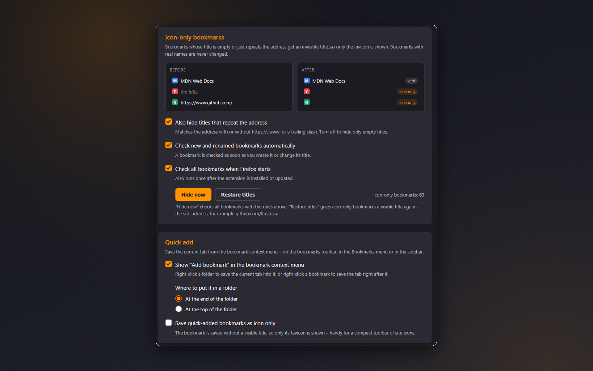

# Clean Bookmarks

Tidier bookmark folders and faster saving: empty or URL-like bookmark titles are hidden so folders show a clean, icon-only view, and every bookmarks folder gets a quick **Add bookmark** menu item.

**[Install from addons.mozilla.org](https://addons.mozilla.org/firefox/addon/cleanbookmarks/)**

## Screenshots

| | |
|:---:|:---:|
|  Empty or URL-like bookmark titles are hidden, so folders show a clean, icon-only view – and every bookmarks folder menu gets an Add bookmark item. |  Settings with a live before/after example: hide empty titles and titles that repeat the address, check bookmarks automatically, hide or restore titles in one click, and choose how Add bookmark saves tabs. |
|  Right-click a folder on the bookmarks toolbar and choose Add bookmark to save the current tab there in one step. |   |

## Features
- **Icon-only view for nameless bookmarks** - when a bookmark title is empty or just repeats its URL (with or without `https://`, `www.` or a trailing slash), it's replaced with an invisible title so only the favicon remains. Bookmarks with real names are never touched.
- **Always up to date** - bookmarks are checked on install, at every browser start, and as soon as one is created or renamed. **Hide now** runs a check manually and tells you how many titles were hidden.
- **Restore titles** - gives icon-only bookmarks a visible title again (the site address, e.g. `github.com/Kustrica`) after a confirmation.
- **Quick add to any folder** - right-click a bookmarks folder and choose **Add bookmark** to save the current tab into it, or right-click a bookmark to save the tab right after it.
- **Interface language** - follow the browser language or pick any of the 19 languages in the Options header.

## Options
| Setting | Default | What it does |
|---|---|---|
| Also hide titles that repeat the address | On | Off = hide only empty titles |
| Check new and renamed bookmarks automatically | On | Checks a bookmark as soon as it is created or its title changes |
| Check all bookmarks when Firefox starts | On | Also runs once after install or update |
| Show "Add bookmark" in the bookmark context menu | On | Toggles the quick-add menu item |
| Where to put it in a folder | At the end | Or at the top of the folder |
| Save quick-added bookmarks as icon only | Off | Saves the tab without a visible title |

Buttons: **Hide now** (check all bookmarks right away) and **Restore titles** (undo the icon-only view; automatic checks are turned off so the titles stay visible).

## Technical details
- Manifest V3, event-based, no background activity when idle
- Permissions: `bookmarks` (fix titles, add bookmarks), `contextMenus` (the "Add bookmark" item), `tabs` (current tab's title and address), `storage` (settings)
- Settings are stored locally - **no data collection**, tracking, or analytics
- `node scripts/check-locales.js` validates all locales

## Localization
Translated into **19 languages**: English, Spanish, German, French, Russian, Belarusian, Chinese (Simplified and Traditional), Japanese, Portuguese (Brazil), Italian, Korean, Polish, Dutch, Turkish, Ukrainian, Indonesian, Arabic, and Vietnamese.

## Support
[Telegram](https://t.me/kustric) · [Ko-fi](https://ko-fi.com/kustrica) · [Patreon](https://www.patreon.com/kustrica) · [Boosty](https://boosty.to/kustrica)
