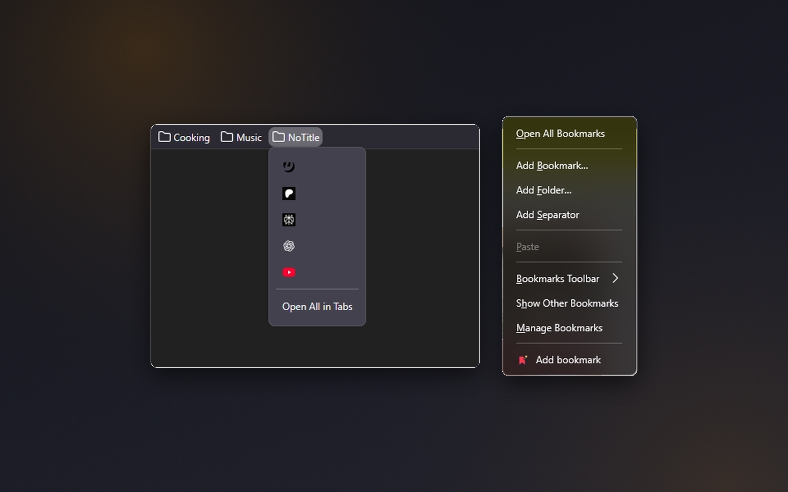
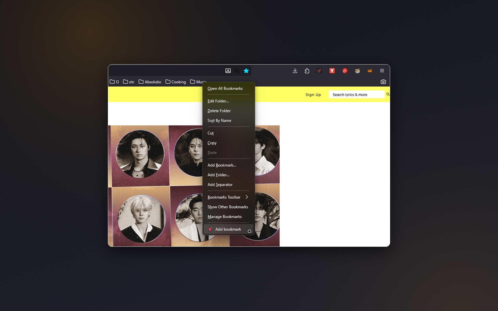

# Clean Bookmarks

Tidier bookmark folders and faster saving: empty or URL-like bookmark titles are hidden so folders show a clean, icon-only view, and every bookmarks folder gets a quick **Add bookmark** menu item.

**[Install from addons.mozilla.org](https://addons.mozilla.org/firefox/addon/cleanbookmarks/)**

## Screenshots

| | |
|:---:|:---:|
|  Empty or URL-like bookmark titles are hidden, so folders show a clean, icon-only view – and every bookmarks folder menu gets an Add bookmark item. |  Right-click a folder on the bookmarks toolbar and choose Add bookmark to save the current tab there in one step. |

## Features
- **Auto-hide empty titles** – when a bookmark title is empty or just repeats its URL, it's replaced with an invisible title so only the favicon remains.
- **Quick add from the folder menu** – right-click any bookmarks folder and choose **Add bookmark** to save the current tab to that folder in one step.

## Technical details
- Manifest V3, event-based, no background activity when idle
- **No data collection**, tracking, or analytics

## Localization
Translated into **19 languages**: English, Spanish, German, French, Russian, Belarusian, Chinese (Simplified and Traditional), Japanese, Portuguese, Italian, Korean, Polish, Dutch, Turkish, Ukrainian, Indonesian, Arabic, and Vietnamese.

## Support
[Telegram](https://t.me/kustric) · [Ko-fi](https://ko-fi.com/kustrica) · [Patreon](https://www.patreon.com/kustrica) · [Boosty](https://boosty.to/kustrica)
